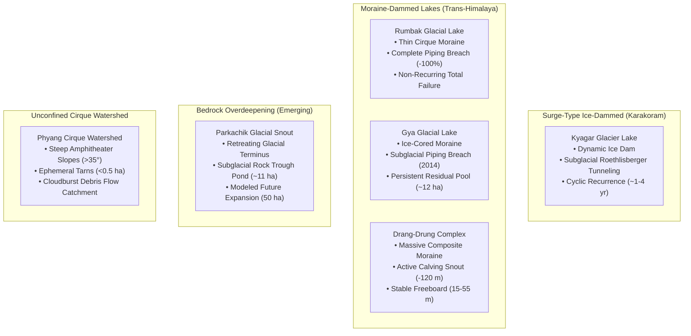

# GLACIAL FORENSICS — Deliverable 7: Comparative Physical Interpretation of All Six Sites

**Investigation:** Comprehensive Forensic Taxonomy and Physical Mechanisms Across Ladakh and Karakoram  
**Coverage:** Rumbak, Drang-Drung, Kyagar, Gya, Parkachik, Cirque (Phyang)  

---

## 1. Comparative Physical Taxonomy Matrix

---

## 2. Deep Physical Comparison

### A. Water Storage & Retention Dynamics
- **Complete Evacuation Archetype (Rumbak):** Rumbak demonstrated complete 100% loss ($2.04\text{ ha} \to 0.00\text{ ha}$). The moraine was completely incised down to the bedrock threshold, leaving zero residual water storage.
- **Cyclic Subglacial Drain-Fill Archetype (Kyagar):** Kyagar is governed by the flotation threshold and subglacial conduit thermodynamics. In August 2018, $78.7\%$ of the lake surface ($21.42\text{ ha}$, $4.82\text{ MCM}$) drained through an englacial/subglacial tunnel beneath the 1,200 m wide ice tongue. In subsequent seasons, plastic ice flow re-sealed the gorge, allowing cyclic replenishment.
- **Residual Containment Archetype (Gya):** Following the 2014 subglacial piping outburst, the moraine did not completely unravel. A deep residual water basin ($6.5\text{ to }12.8\text{ ha}$) remains impounded behind a relict moraine sill.
- **Secular Proglacial Growth Archetype (Drang-Drung & Parkachik):** Both Drang-Drung and Parkachik exhibit progressive water expansion driven by glacier retreat into overdeepened subglacial basins. Drang-Drung proglacial water fluctuates between $16\text{ and }25\text{ ha}$ across multiple ponds, while Parkachik has grown from an ephemeral pond in 2015 to $11.1\text{ ha}$ in 2024.
- **Non-Lake Cirque Archetype (Phyang):** Phyang lacks any natural moraine dam capable of impounding more than $0.5\text{ to }1.5\text{ ha}$ of shallow meltwater.

### B. Dam Morphology & Failure Modes
1. **Piping Failure through Ice-Cored Moraines:** Both Rumbak (2021) and Gya (2014) failed via internal thermo-erosion and piping rather than external wave overtopping. Permafrost degradation within the moraine core opened subsurface conduits that collapsed under hydrostatic pressure.
2. **Subglacial Hydraulic Jacking / Tunneling:** Kyagar represents pure ice dam hydraulics. The dam fails when hydrostatic head at the ice-dam contact ($
ho_w g h$) reaches $\sim 90\%$ of cryostatic pressure ($
ho_i g H$), initiating subglacial water discharge that widens via frictional melting.
3. **Composite Moraine Stability with Calving Overtopping Threat:** Drang-Drung is protected by a massive composite moraine rampart exceeding 250 m in width and 25 m in freeboard. Static structural failure is unlikely; the dominant threat is dynamic displacement waves generated by hanging ice avalanches or calving cliff collapse.

### C. Downstream Hydraulic Gradient & Energy
- **Rumbak Gorge:** $1,398\text{ m}$ drop over $7.0\text{ km}$ ($0.200\text{ m/m}$, $11.31^\circ$). High gradient transformed the $400,000\text{ m}^3$ breach into a devastating boulder-bearing hyperconcentrated debris flow.
- **Gya Nala:** $1,170\text{ m}$ drop over $9.4\text{ km}$ ($0.125\text{ m/m}$, $7.13^\circ$). Moderate-to-steep gorge delivering destructive slurry directly to Gya village and the Leh-Manali Highway.
- **Phyang Tokpo:** $1,480\text{ m}$ drop over $8.0\text{ km}$ ($0.185\text{ m/m}$, $10.48^\circ$). Extreme gradient prone to cloudburst debris flows scouring sediment down to the Indus plain.
- **Drang-Drung to Padum:** $0.045\text{ m/m}$ gradient along the broad Stod River valley, attenuating flood wave peaks over long transit distances.
- **Kyagar to Yarkant:** $0.038\text{ m/m}$ gradient through the deeply incised, uninhabited Shaksgam canyon before debouching onto the Xinjiang agricultural oases.
