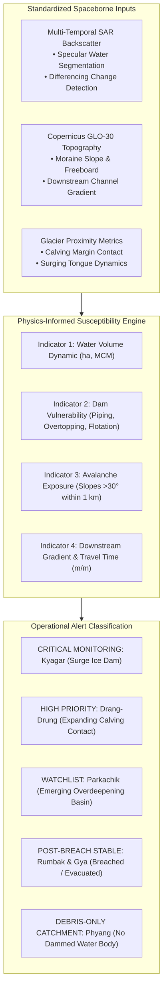

# GLACIAL FORENSICS — Deliverable 9: Recommended Next Stage for GLOF-WATCH Application

**Roadmap:** Transitioning from Static Multi-Site Forensics to Automated Operational GLOF Early-Warning  
**Platform:** GLOF-WATCH / Antigravity Interactive Radar Intelligence Platform  

---

## 1. Physics-Informed Susceptibility Framework (Stage 5 Deliverable)

Rather than assigning arbitrary, uncalibrated probability scores, GLOF-WATCH implements a **multi-criteria physical susceptibility indicator matrix**:

### Susceptibility Classification Matrix

| Site Name | Lake Area ($A$) | Dam Freeboard ($H_f$) | Calving Contact ($C_g$) | Aval. Threat ($S_{30}$) | Hyd. Gradient ($G_h$) | Human Exposure | Physics-Based Susceptibility Tier | Recommended Monitoring Cadence |
| :--- | :---: | :---: | :---: | :---: | :---: | :--- | :--- | :--- |
| **Kyagar** | 27.2 ha | 70 m (Ice) | Surge Tongue | High (65°) | 0.038 m/m | Yarkant Oasis | **CRITICAL: Recurrent Surge Dam** | Bi-weekly S1 + NISAR L-band during ablation |
| **Drang-Drung** | 17.4 ha | 25 m (Till) | Active (120 m) | High (48°) | 0.045 m/m | NH-301 Highway | **HIGH: Expanding Calving Lake** | Monthly S1 anniversary tracking |
| **Parkachik** | 11.1 ha | 18 m (Rock) | Active Calving | High (52°) | 0.052 m/m | Suru Valley | **WATCHLIST: Emerging Overdeepening** | Bi-monthly S1 tracking during melt season |
| **Gya** | 12.1 ha | 8 m (Till) | Detached (350m) | Mod (38°) | 0.125 m/m | Gya Village / NH-3 | **MODERATE: Residual Lake Breach Remnant** | Annual post-monsoon inspection |
| **Rumbak** | 0.0 ha | 0 m (Breached)| Detached (150m) | High (42°) | 0.200 m/m | Rumbak Village | **STABLE: Breached Empty Basin** | Low (Occasional landslide check) |
| **Phyang** | 0.5 ha | None (Scree) | Detached (50m) | High (45°) | 0.185 m/m | Phyang Village | **DEBRIS CATCHMENT (Non-GLOF)** | Meteorological cloudburst radar only |

---

## 2. Recommended Next Stage Implementation Roadmap

1. **Automated STAC Polling Ingestion:** Incorporate an automated background crawler into `glof_watch.harvester` that polls the Planetary Computer STAC endpoint every 6 days for new Sentinel-1 acquisitions over the 6 monitored sectors.
2. **NISAR L-band Integration Pipeline:** Prepare ingestion handlers for NISAR L-band GCOV (Geocoded Calibrated Backscatter) products to penetrate seasonal ice crusts during early spring filling.
3. **GUI Interactive Multi-Lake Screen:** Extend the PyQt/VisPy desktop application (`glof_watch.ui`) to include the standardized 6-site comparative analytics tab, enabling interactive threshold sliders and 3D terrain draping across all six locations.
4. **Hydraulic Flood Routing Module:** Couple the extracted water volume ($V$) and breach geometry with a 1D/2D shallow-water flood routing solver (e.g., HEC-RAS or simplified Manning's kinetic wave) to project downstream flood wave arrival times.
