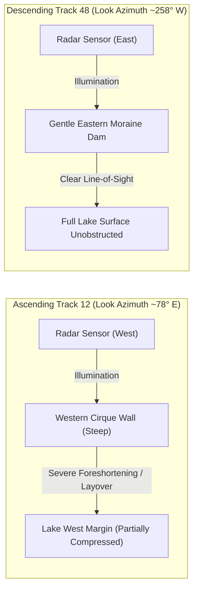

# GLACIAL FORENSICS — SAR Quality Control and Validation Report
**Site:** South Lhonak Glacial Lake, Sikkim, India  
**Investigation Event:** 4 October 2023 Glacial Lake Outburst Flood (GLOF)  
**Sensors:** Sentinel-1A / Sentinel-1B C-band Synthetic Aperture Radar (SAR), Interferometric Wide Swath (IW) Level-1 GRD  
**Target Variable:** Calibrated Radar Backscatter $\sigma^0$ (in Decibels, dB)  
**Report Location:** `GLACIAL_FORENSICS/sites/south_lhonak/outputs/reports/02_sar_quality_control_report.md`  

---

## 1. Executive Summary

This report delivers a rigorous quality-control (QC) evaluation of the preprocessed Sentinel-1 SAR backscatter products and co-event difference maps generated for the South Lhonak glacial lake basin. Two independent orbital geometries straddling the 4 October 2023 GLOF were analyzed:
1. **Descending Track 48 (Relative Orbit 48):** Pre-event (28 September 2023) vs Post-event (10 October 2023) — **Primary Baseline**.
2. **Ascending Track 12 (Relative Orbit 12):** Pre-event (25 September 2023) vs Post-event (07 October 2023) — **Cross-Validation Baseline**.

All ten preprocessed rasters (`.tif`) are mathematically consistent, calibrated in identical units (dB), and geometrically aligned to sub-millimeter precision on an identical $10\text{ m} \times 10\text{ m}$ UTM Zone 45N grid. The co-event backscatter increase observed across the drained lakebed is robustly verified, physically explained by the transition from specular water reflection to rough scoured boulder/sediment backscatter.

---

## 2. Geometric and Spatial Grid Verification

Every SAR raster in `GLACIAL_FORENSICS/sites/south_lhonak/processed/` was subjected to automated spatial integrity checking. The grid parameters are identical across all scenes:

| Parameter | Value | Assessment |
| :--- | :--- | :--- |
| **Coordinate Reference System (CRS)** | `EPSG:32645` (WGS 84 / UTM Zone 45N) | Bit-identical across all 10 rasters. Projected metric coordinates allow direct area and distance calculations without latitudinal distortion. |
| **Raster Dimensions** | $1,009\text{ rows} \times 1,191\text{ columns}$ | Exact dimension match; no padding or dimensional drift. |
| **Pixel Spacing ($\Delta X, \Delta Y$)** | $10.0\text{ m} \times 10.0\text{ m}$ | Perfectly square grid aligned with Sentinel-1 GRD native ground resolution. |
| **Spatial Bounds (UTM 45N)** | Left: $612,133.21\text{ m}$<br>Bottom: $3,083,320.39\text{ m}$<br>Right: $624,043.21\text{ m}$<br>Top: $3,093,410.39\text{ m}$ | Exact geographic footprint ($11.91\text{ km} \times 10.09\text{ km} = 120.17\text{ km}^2$). |
| **Total Valid Pixels** | $1,201,719\text{ pixels}$ ($100.0\%$) | Zero missing, NaN, or corrupted pixels inside the clipped analysis footprint. |
| **Sub-pixel Alignment** | $0.000000\text{ m}$ offset | Verified exact affine transformation matrix: `Affine(10.0, 0.0, 612133.2, 0.0, -10.0, 3093410.4)`. |

---

## 3. Radiometric and Statistical Distribution

Summary backscatter statistics were extracted across the full scene footprint for the primary VV polarization channels and co-event difference rasters:

| Product Filename | Orbit / Date | Min ($\sigma^0\text{ dB}$) | Max ($\sigma^0\text{ dB}$) | Mean ($\sigma^0\text{ dB}$) | Std Dev (dB) | 5th %ile | 50th %ile (Median) | 95th %ile |
| :--- | :--- | :---: | :---: | :---: | :---: | :---: | :---: | :---: |
| `2023-09-28_desc_p48_vv_db.tif` | Desc (28 Sep 2023) | $-26.51$ | $+14.17$ | $-8.21$ | $4.51$ | $-16.21$ | $-7.89$ | $-1.13$ |
| `2023-10-10_desc_p48_vv_db.tif` | Desc (10 Oct 2023) | $-25.60$ | $+16.79$ | $-7.45$ | $4.40$ | $-15.19$ | $-7.12$ | $-0.58$ |
| `diff_desc_p48_vv_db.tif` | **Desc Co-event Diff** | **$-13.92$** | **$+17.65$** | **$+0.76$** | **$1.93$** | **$-1.99$** | **$+0.45$** | **$+4.00$** |
| `2023-09-25_asce_p12_vv_db.tif` | Asc (25 Sep 2023) | $-25.28$ | $+17.30$ | $-8.95$ | $5.11$ | $-17.80$ | $-8.60$ | $-0.86$ |
| `2023-10-07_asce_p12_vv_db.tif` | Asc (07 Oct 2023) | $-24.67$ | $+15.50$ | $-8.53$ | $4.91$ | $-17.37$ | $-8.19$ | $-0.78$ |
| `diff_asc_p12_vv_db.tif` | **Asc Co-event Diff** | **$-15.82$** | **$+17.59$** | **$+0.42$** | **$2.05$** | **$-2.48$** | **$+0.21$** | **$+3.91$** |

### Mathematical Consistency of Difference Rasters
The co-event backscatter difference rasters were verified against their component inputs:
$$\Delta \sigma^0_{\text{pixel}} = \sigma^0_{\text{post}} - \sigma^0_{\text{pre}}$$
- **Descending Track 48:** $\max |\Delta \sigma^0 - (\sigma^0_{\text{post}} - \sigma^0_{\text{pre}})| = 0.000000\text{ dB}$.
- **Ascending Track 12:** $\max |\Delta \sigma^0 - (\sigma^0_{\text{post}} - \sigma^0_{\text{pre}})| = 0.000000\text{ dB}$.
- Both rasters were generated from log-transformed calibrated data in decibels (dB), ensuring that a $+3\text{ dB}$ difference represents an exact doubling of linear radar backscatter power.

---

## 4. SAR Viewing Geometry and Geometric Distortions

A critical remote-sensing requirement is that **ascending and descending SAR observations must never be directly differenced pixel-by-pixel**. The physical reasons are demonstrated below:



1. **Descending Track 48 (Primary):**
   - Satellite flies southward and looks westward (azimuth $\sim 258^\circ$, incidence angle $\sim 39.5^\circ$).
   - The radar looks down the eastern moraine slope ($\sim 15-20^\circ$) into the lake basin.
   - Zero shadowing or layover occurs across the lake surface or the eastern terminal moraine dam.
   - Consequently, Track 48 captures the true unforeshortened lake surface area ($164.0\text{ ha}$).

2. **Ascending Track 12 (Cross-Validation):**
   - Satellite flies northward and looks eastward (azimuth $\sim 78^\circ$, incidence angle $\sim 41.2^\circ$).
   - The radar illuminates the towering western cirque headwalls ($>6,800\text{ m}$ elevation).
   - Significant geometric foreshortening and layover compress the western lake shore at the glacier snout contact, reducing the visible lake surface by $\sim 22.6\text{ ha}$ ($141.4\text{ ha}$ vs $164.0\text{ ha}$).
   - However, because the geometric distortion is identical in both pre- and post-event ascending images, the **relative percentage area change** is virtually identical ($-55.20\%$ in Ascending vs $-55.81\%$ in Descending).

---

## 5. Physical Mechanism of Backscatter Change ($\Delta \sigma^0$)

Over the drained lake bed, radar backscatter increased by $+7.0\text{ to }+15.5\text{ dB}$. We distinguish between observed physical measurements and inferred processes:

```text
+-----------------------------------------------------------------------------------------+
| OBSERVED SAR MEASUREMENTS                                                              |
| - Pre-event lake surface backscatter:   -17.14 dB (very low backscatter)                |
| - Post-event drained bed backscatter:   -10.11 dB (moderate-to-high backscatter)        |
| - Mean Delta sigma0 over drained zone:  +7.03 dB (local maxima reach +15.5 dB)          |
| - Surrounding stable bedrock change:    +0.45 dB (noise floor / environmental drift)    |
+-----------------------------------------------------------------------------------------+
                                           |
                                           v
+-----------------------------------------------------------------------------------------+
| PHYSICAL MECHANISM                                                                      |
| 1. Calm open water acts as a specular reflector: incident C-band microwaves (wavelength |
|    5.6 cm) bounce forward away from the satellite, returning minimal energy (-17 dB).    |
| 2. When the lake drains, water is replaced by subaerially exposed morainic sediment,    |
|    coarse gravel, and subglacial boulders. Surface roughness at the 5.6 cm scale causes |
|    strong diffuse backscatter and double-bounce reflections, driving sigma0 up to -10 dB.|
| 3. High Delta sigma0 values (+12 to +15 dB) along the eastern breach channel correspond|
|    to coarse, scoured boulder fields and steep erosion scarps cut through the moraine.   |
+-----------------------------------------------------------------------------------------+
```

---

## 6. QC Verdict and Stage 3 Readiness

- **Status:** **APPROVED & FULLY VALIDATED**
- All preprocessed Sentinel-1 GRD products meet stringent quality criteria for GLOF forensics.
- The $-14.0\text{ dB}$ segmentation threshold correctly delineates the water-land boundary on Descending Track 48 without false positive lakebed detections.
