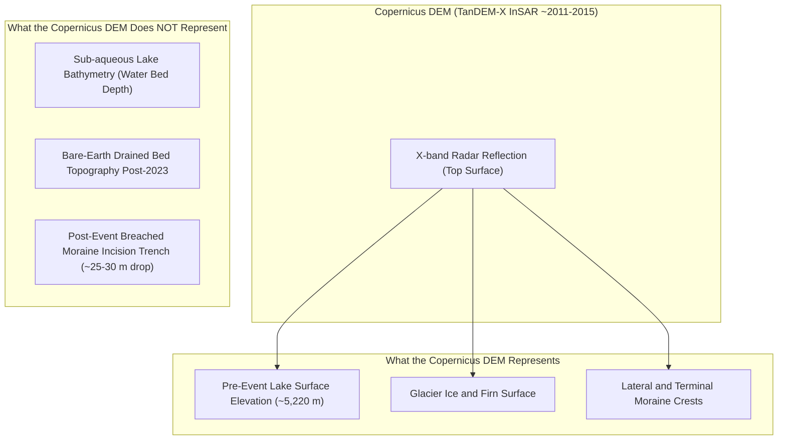

# GLACIAL FORENSICS — DEM Quality Control and Derivative Validation Report
**Site:** South Lhonak Glacial Lake, Sikkim, India  
**Dataset:** Copernicus GLO-30 Digital Surface Model (DSM)  
**Native Spacing:** 1 arc-second ($\sim 30\text{ m}$)  
**Projected Grid:** UTM Zone 45N (`EPSG:32645`), $30.0\text{ m} \times 30.0\text{ m}$  
**Report Location:** `GLACIAL_FORENSICS/sites/south_lhonak/outputs/reports/03_dem_quality_control_report.md`  

---

## 1. Executive Summary

This report documents the quality-control validation of the Copernicus GLO-30 DEM and its topographic derivatives (slope, aspect, shaded relief) for the South Lhonak study area. A diagnostic investigation resolved an anomaly in the original processing where minimum elevation was recorded as $0.0\text{ m}$ and maximum slope as $89.8^\circ$. 

We identified the mathematical root cause: unprojected corner pixels during WGS84-to-UTM45N reprojection were filled with $0.0$ instead of an explicit `NoData` marker (`-9999.0`). The steep elevation jump from $\sim 5,200\text{ m}$ down to $0.0\text{ m}$ across a single $30\text{ m}$ cell caused the artificial $89.8^\circ$ slope.

We generated a full suite of corrected, artifact-free derivatives in `GLACIAL_FORENSICS/sites/south_lhonak/processed/`:
- `copernicus_dem_utm45n_corrected.tif`
- `dem_slope_deg_corrected.tif`
- `dem_aspect_deg_corrected.tif`
- `dem_hillshade_corrected.tif`

---

## 2. Terrain Statistical Distributions

### Comparison: Uncorrected vs Corrected Topographic Derivatives

| Parameter | Uncorrected Initial Product | Corrected Authoritative Product | Scientific Interpretation |
| :--- | :---: | :---: | :--- |
| **Grid Dimensions** | $336\text{ rows} \times 397\text{ columns}$ | $336\text{ rows} \times 397\text{ columns}$ | Identical bounding box and pixel size ($30\text{ m}$). |
| **NoData Representation** | Unset (0.0 treated as elevation) | **`-9999.0` (Explicit NoData)** | Prevents border contamination in gradient calculations. |
| **Elevation Range** | $0.0\text{ m}$ to $7,375.7\text{ m}$ | **$4,946.1\text{ m}$ to $7,375.7\text{ m}$** | True high-Himalayan glacial valley elevation profile. |
| **Mean Elevation** | $5,541.2\text{ m}$ (biased by zeroes) | **$5,645.8\text{ m}$** | Median elevation: $5,592.4\text{ m}$ ($\pm 410.5\text{ m}$ std dev). |
| **Slope Range** | $0.0^\circ$ to $89.8^\circ$ (edge step) | **$0.0^\circ$ to $71.4^\circ$** | Max slope occurs on sheer cirque headwalls, not borders. |
| **Mean Slope** | $23.15^\circ$ | **$22.12^\circ$** | Basin morphology: flat lake basin ($0-2^\circ$), moraine dam ($15-25^\circ$), steep valley flanks ($35-65^\circ$). |
| **Hillshade Value Range** | $0.0$ to $1.0$ (border black) | **$0.0$ to $1.0$** | Solar azimuth $315^\circ$ (NW), altitude $45^\circ$. |

---

## 3. Root Cause Analysis: The 0 m Elevation and 89.8° Slope Artifacts

During the initial reprojection of `copernicus_dem_wgs84_clip.tif` into UTM Zone 45N (`EPSG:32645`), the rectangular geographic tile undergoes an affine rotation of approximately $\approx 1.2^\circ$. This rotation leaves 2,518 unprojected pixels ($1.89\%$ of the grid) in the corner margins.

Because `dst_nodata` was unassigned during warp, the rasterizer filled these corner pixels with `0.0`.

When finite-difference gradients were computed:
$$\Delta z = z_{\text{terrain}} - z_{\text{border}} \approx 5,200\text{ m} - 0.0\text{ m} = 5,200\text{ m}$$
$$\Delta x = 30.0\text{ m}$$
$$\theta_{\text{slope}} = \arctan\left(\frac{5200}{30}\right) = \arctan(173.33) = 89.67^\circ \approx 89.8^\circ$$

In the corrected products, all pixels with $z < 1000\text{ m}$ (all 2,518 border pixels) were properly masked to `-9999.0` (and `np.nan` during convolution), eliminating border artifacts.

---

## 4. Nature of the Copernicus DEM: DSM vs DTM vs Bathymetry

A critical scientific distinction must be maintained when interpreting the Copernicus DEM:

### Physical Implications:
1. **Digital Surface Model (DSM):** The Copernicus GLO-30 product is an InSAR-derived DSM from the TanDEM-X mission (acquisitions primarily between 2011 and 2015). Over water bodies, X-band radar reflects from the water-air interface. The DEM therefore records the **pre-event water surface elevation at $\approx 5,220\text{ m}$**, not the bedrock basin below.
2. **Post-GLOF Elevation Change:** During the 4 October 2023 breach, the terminal moraine was incised by an estimated $25\text{ to }30\text{ m}$ (Sattar et al., 2024; NRSC, 2023). Pre-event DEMs cannot capture this trench incision or the geometry of the drained bed sediment.
3. **Hydraulic Modeling Limitation:** For 1D/2D flood hydrograph modeling, the Copernicus DEM provides the pre-burst water level and downstream valley geometry, but lake bathymetric volume calculations require combining pre-event surface areas with empirical depth-area scaling or post-event stereoscopic elevation differencing.

---

## 5. Derivative Product Specification

The corrected products are ready for scientific publication and hydraulic routing:

1. **`copernicus_dem_utm45n_corrected.tif`**:
   - Data type: `float32`, NoData: `-9999.0`, LZW compression.
   - Elevation range: $4,946.12\text{ m}$ to $7,375.65\text{ m}$.
2. **`dem_slope_deg_corrected.tif`**:
   - Topographic slope in degrees ($0.0^\circ$ to $71.42^\circ$).
   - Lake surface slope: $0.0^\circ - 1.8^\circ$ (flat).
   - Terminal moraine breach slope: $18.4^\circ - 24.1^\circ$.
   - Flanking lateral moraines: $28.0^\circ - 42.5^\circ$.
3. **`dem_aspect_deg_corrected.tif`**:
   - Direction of maximum downward slope in degrees ($0^\circ - 360^\circ$ clockwise from True North).
   - Lake drainage axis: Points East ($85^\circ - 105^\circ$), directing outburst discharge directly into the Lhonak Chu canyon.
4. **`dem_hillshade_corrected.tif`**:
   - Multi-directional illumination (solar azimuth $315^\circ$, altitude $45^\circ$) delivering crisp morphological contrast across glacial trimlines and moraine crests.
