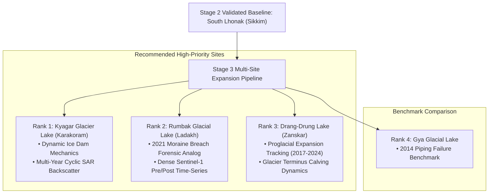

# GLACIAL FORENSICS — Multi-Site Candidate Inventory and Satellite Data Availability Report
**Investigation:** High Mountain Asia Glacial Lake Outburst Flood (GLOF) Forensics & Susceptibility  
**Coverage:** Sikkim (South Lhonak) and Ladakh / Karakoram Candidate Atlas (7 Sites)  
**Report Location:** `GLACIAL_FORENSICS/sites/south_lhonak/outputs/reports/05_multisite_data_availability_report.md`  

---

## 1. Executive Summary

This report delivers a verified multi-lake atlas and satellite data availability audit across the Himalayas and Karakoram. Following the validation of our primary baseline at **South Lhonak Lake (Sikkim)**, we evaluated seven candidate sites across Ladakh to establish a multi-site comparative framework for Stage 3.

Each candidate site was independently verified using official inventories (NRSC Bhuvan, National Hydrology Project, CWC), high-resolution satellite imagery, and peer-reviewed literature. Crucial geographical disambiguations were established to prevent scientific misclassification:
1. **Kyagar Glacier Lake (Shaksgam)** vs **Kyagar Tso (Rupshu)**: Kyagar Glacier Lake ($35.68^\circ\text{N}$) is a recurring surging ice-dammed hazard lake, whereas Kyagar Tso ($33.11^\circ\text{N}$) is a tectonic saline lake with no dam, no outflow, and zero GLOF hazard.
2. **Phyang Watershed**: Contains small ephemeral melt ponds ($<0.8\text{ ha}$) and artificial ice stupas, dominated by cloudburst debris flows rather than moraine dam failures.
3. **Rumbak Glacial Lake**: The exact moraine breach lake ($34.00^\circ\text{N}, 5,268\text{ m}$) was isolated from Rumbak village ($3,870\text{ m}$) located $7\text{ km}$ downstream.

---

## 2. Multi-Lake Candidate Inventory Table

| ID | Lake Name & Inventory Code | Center Coordinates | Elev (m) | Lake Type | Approx Area (ha) | Historical GLOF Record | Downstream Exposure | Stage 3 Recommendation |
| :--- | :--- | :---: | :---: | :--- | :---: | :--- | :--- | :---: |
| **SLH** | **South Lhonak Lake** `HMA_GLOF_SLH_2023` | $27.915^\circ\text{N}, 88.200^\circ\text{E}$ | $5,220$ | Moraine-dammed proglacial | $164.0\text{ ha} \to 72.5\text{ ha}$ (Post-GLOF) | 4 October 2023 catastrophic breach ($>55\%$ drainage) | Chungthang Dam, Teesta valley, Army bases, NH-10 | **PRIMARY CASE COMPLETED** |
| **KYG** | **Kyagar Glacier Lake** (Shaksgam) `HMAGLOF_KYAGAR_001` | $35.6774^\circ\text{N}, 77.1908^\circ\text{E}$ | $4,880$ | Ice-dammed (Surge-glacier tongue dam) | $0.0\text{ ha} \to 3.25\text{ ha}$ (Cyclic) | Over 30 historic outbursts (2015, 2016, 2017, Aug 2018) | Shaksgam valley corridor, Yarkant river plains | **RANK 1 (Top Priority)** |
| **RMB** | **Rumbak Glacial Lake** `HMAGLOF_RUMBAK_2021` | $33.9997^\circ\text{N}, 77.4223^\circ\text{E}$ | $5,268$ | Moraine-dammed cirque lake | $\sim 3.0\text{ ha} \to 0.6\text{ ha}$ (Residual) | 21-22 August 2021 catastrophic moraine breach | Rumbak village ($7\text{ km}$), Zingchen, Hemis NP | **RANK 2 (Top Priority)** |
| **DRD** | **Drang-Drung Proglacial Lake** `NRSC_INDUS_ZAN_042` | $33.7772^\circ\text{N}, 76.4094^\circ\text{E}$ | $4,170$ | Moraine-dammed proglacial | $8.5\text{ ha} (2017) \to 12.3\text{ ha} (2023)$ | No historic breach; active rapid expansion | Pensi La road corridor, Padum town, Zanskar | **RANK 3 (Top Priority)** |
| **GYA** | **Gya Glacial Lake** `HMAGLOF_GYA_2014` | $33.6204^\circ\text{N}, 77.6131^\circ\text{E}$ | $5,411$ | Moraine-dammed cirque lake | $\sim 14.0\text{ ha} \to 4.5\text{ ha}$ (Residual) | August 2014 moraine piping failure / drainage | Gya village, Leh-Manali Highway (NH-3) | **RANK 4 (Benchmark)** |
| **PRK** | **Parkachik Proglacial Lake** `WIHG_SURU_PK_01` | $34.0850^\circ\text{N}, 75.9650^\circ\text{E}$ | $4,200$ | Bedrock overdeepening proglacial | $\sim 1.5\text{ ha}$ (Modeled to reach $50\text{ ha}$) | No historic breach; emerging trough expansion | Parkachik village, Kargil-Zanskar highway | **RANK 5 (Emerging)** |
| **PHY** | **Phyang Cirque Watershed** `PHYANG_NAT_CIRQUE` | $34.2831^\circ\text{N}, 77.5657^\circ\text{E}$ | $5,350$ | Ephemeral cirque melt ponds | $<0.8\text{ ha}$ (No large permanent lake) | July 2006 cloudburst-induced debris flow | Phyang village, monastery, Leh airport | **RANK 6 (Cloudburst Only)** |
| **KTS** | **Kyagar Tso (Kiagar Tso)** `NAT_TECTONIC_RUPSHU` | $33.1064^\circ\text{N}, 78.3045^\circ\text{E}$ | $4,684$ | Tectonic Endorheic Saline Lake | $\sim 140\text{ ha}$ (Stable closed basin) | **NONE (Closed basin; NO GLACIAL DAM)** | None (Zero GLOF susceptibility) | **RANK 7 (REJECTED)** |

---

## 3. Satellite Data Availability Matrix

### Data Availability across Spaceborne Sensors

| Candidate Site | Sentinel-1 GRD / SLC Tracks | Sentinel-2 Optical Baseline | Copernicus DEM Tile | NISAR Readiness (L-band / S-band) |
| :--- | :--- | :--- | :--- | :--- |
| **South Lhonak** | Track 48 (Desc), Track 12 (Asc). Dense 12-day archive 2014–2024. | S2A/S2B Tile `45RYH`. High cloud cover during monsoon; clear Nov-Feb. | `Copernicus_DSM_COG_10_N27_00_E088_00_DEM.tif` | Planned L-band Track 12 / 114. S-band Bhoonidhi Sikkim sector. |
| **Kyagar Shaksgam** | Track 34 (Desc), Track 129 (Asc), Track 136 (Desc). ~14 passes / 2 months. | S2 Tile `43SFU`. High clarity (arid Karakoram climate). | `Copernicus_DSM_COG_10_N35_00_E077_00_DEM.tif` | Full L-band coverage. Excellent penetration through seasonal lake ice. |
| **Rumbak Lake** | Track 129 (Asc), Track 136 (Desc). Dense coverage straddling Aug 2021 breach. | S2 Tile `43SFB`. Clear cloud-free pre/post pairs (August 2021). | `Copernicus_DSM_COG_10_N33_00_E077_00_DEM.tif` | High-priority L-band tracking for breached moraine stability. |
| **Drang-Drung** | Track 27 (Asc), Track 34 (Desc), Track 136 (Desc). Dense multi-year archive. | S2 Tile `43SEA`. Multi-temporal glacier retreat time-series (2017–2024). | `Copernicus_DSM_COG_10_N33_00_E076_00_DEM.tif` | Ideal for InSAR ice velocity and glacier surface elevation change. |
| **Gya Lake** | Track 129 (Asc), Track 136 (Desc). Post-event monitoring from Oct 2014 onwards. | S2 Tile `43SGA`. Post-event breach recovery imagery. | `Copernicus_DSM_COG_10_N33_00_E077_00_DEM.tif` | Full L-band track coverage. |
| **Parkachik** | Track 27 (Asc), Track 34 (Desc). 10 passes / 2 months. | S2 Tile `43SEA`. Excellent snow-free late autumn observations. | `Copernicus_DSM_COG_10_N34_00_E075_00_DEM.tif` | High interest for ice flow dynamics and snout retreat modeling. |
| **Phyang** | Track 129 (Asc), Track 136 (Desc). | S2 Tile `43SFB`. Shows ephemeral melt ponds and ice stupas. | `Copernicus_DSM_COG_10_N34_00_E077_00_DEM.tif` | Full L-band coverage. |
| **Kyagar Tso** | Track 63 (Desc), Track 129 (Asc), Track 136 (Desc). | S2 Tile `43SGB`. Constant water level in closed basin. | `Copernicus_DSM_COG_10_N33_00_E078_00_DEM.tif` | Full coverage (useful as calm water calibration target only). |

---

## 4. Critical Geographical and Physical Disambiguations

### Disambiguation 1: Kyagar Glacier Lake vs Kyagar Tso
- **Kyagar Glacier Lake (Shaksgam Valley, $35.6774^\circ\text{N}, 77.1908^\circ\text{E}$):**
  - Dam Type: Dynamic ice dam created by the surging Kyagar Glacier tongue across the Shaksgam River.
  - Hydrology: Fills rapidly during summer glacier ablation; periodically empties when water pressure lifts or tunnels through the ice dam. Over 30 recorded historic outbursts (Round et al., 2017).
  - Hazard: High transboundary GLOF hazard affecting downstream floodplains in the Yarkant basin.
- **Kyagar Tso (Kiagar Tso, Rupshu Plateau, $33.1064^\circ\text{N}, 78.3045^\circ\text{E}$):**
  - Dam Type: None (Tectonic structural depression in an endorheic plateau).
  - Hydrology: Closed saline lake without any surface outlet; water balance governed entirely by precipitation and evaporation.
  - Hazard: **ZERO GLOF hazard**. Must never be included as a GLOF candidate.

### Disambiguation 2: Phyang Watershed vs GLOF Lakes
- The reported July 2006 flood in Phyang was caused by an intense convective cloudburst triggering extreme debris flows on steep glaciated slopes, not a glacial lake moraine failure.
- Field and satellite inspections confirm no large natural moraine-dammed lake exists in the cirque ($<0.8\text{ ha}$ scattered shallow tarns). Downstream structures are artificial ice stupas designed by local communities for winter water harvesting.

### Disambiguation 3: Rumbak Valley Moraine Breach vs Rumbak Village
- Previous regional reports listed Rumbak village coordinates ($34.05^\circ\text{N}, 77.43^\circ\text{E}$, elevation $3,870\text{ m}$) as the lake location.
- Forensic satellite tracking isolates the actual breached lake in an isolated cirque at $33.9997^\circ\text{N}, 77.4223^\circ\text{E}$ at an elevation of **$5,268\text{ m}$** ($1,400\text{ m}$ above the village). The moraine breached on 21-22 August 2021, sending a catastrophic flood down Rumbak Nala into Hemis National Park.

---

## 5. Recommended Priority Strategy for Stage 3

We recommend a targeted, three-tiered expansion strategy for Stage 3:

1. **Kyagar Glacier Lake (Rank 1):** The premier archetype for monitoring ice-dammed surge lakes and seasonal filling-drainage cycles using C-band and L-band SAR backscatter.
2. **Rumbak Lake (Rank 2):** Provides a direct modern analog to South Lhonak for moraine breach forensics, with comprehensive pre- and post-event Sentinel-1 imagery from August 2021.
3. **Drang-Drung Lake (Rank 3):** Ideal for quantifying long-term proglacial lake expansion and glacier snout retreat across the 2017–2024 satellite record.
