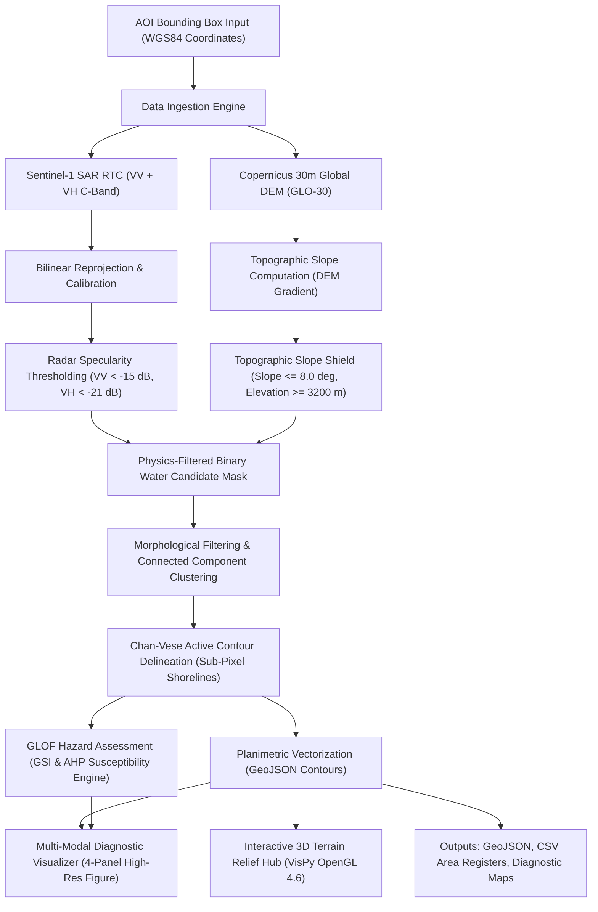

# GlacialLakeDetector

[](https://www.spaceappschallenge.org/)
[](https://www.spaceappschallenge.org/2026/challenges/dancing-with-the-sars/?tab=details)
[](https://python.org)
[](LICENSE)

## Description

GlacialLakeDetector is an automated remote sensing pipeline designed to detect high-altitude glacial lakes and evaluate Glacial Lake Outburst Flood (GLOF) susceptibility across steep mountain catchments.

Standard optical imagery (Sentinel-2, Landsat) is frequently obscured by cloud cover during peak summer melt. Synthetic Aperture Radar (SAR) penetrates clouds, but steep mountain terrain creates radar shadows that mimic calm water bodies. GlacialLakeDetector resolves this by coupling dual-polarization Sentinel-1 SAR (VV/VH) with Copernicus 30m DEM topographic slope modeling: standing water cannot pool on steep terrain (slope <= 8.0 degrees), eliminating mountain shadow false positives before active-contour (Chan-Vese) segmentation extracts exact lake boundaries.

## Working Flowchart



## How to Install and Run

### 1. Requirements & Installation

Requires Python 3.10 or later and GDAL runtime dependencies.

```bash
# Clone the repository
git clone https://github.com/T-Dynamos/GlacialLakeDetector.git
cd GlacialLakeDetector

# Install dependencies
pip install -r requirements.txt
```

### 2. Interactive Desktop GUI

Launch the KivyMD / VisPy desktop workstation interface:

```bash
python3 -m glof_watch.ui.app
```

The GUI provides:
- **Map & AOI**: Interactive map view, bounding box reticle, and target preset selector.
- **Analysis & 3D**: Multi-modal diagnostic plot with zoom controls, real-time pipeline log, and standalone VisPy 3D orbit viewer.
- **Search & Verify**: Inventory catalog search and lake verification against historical benchmarks.

### 3. Command-Line Interface (CLI)

Run detections directly from the command line:

```bash
# Run detection on a preset benchmark (e.g., Gya, Kyagar, Drang-Drung)
python3 -m glof_watch.cli --target gya --plot AUTO

# Run detection on a custom bounding box [min_lon, min_lat, max_lon, max_lat]
python3 -m glof_watch.cli --bbox 77.595 33.605 77.635 33.635 --name "Gya Glacial Lake" --plot AUTO

# List all available prebuilt targets and regional corridors
python3 -m glof_watch.cli --list-targets
```

### 4. Benchmark Area Verification

Compare algorithmic detections against known peer-reviewed lake areas across all benchmark targets:

```bash
python3 compare_target_areas.py
```

Results are printed to the terminal and exported to:
- Markdown Report: [outputs/target_area_comparison.md](outputs/target_area_comparison.md)
- CSV Register: [outputs/target_area_comparison.csv](outputs/target_area_comparison.csv)

### 5. Running Tests

Run the automated test suite:

```bash
pytest tests/
```
